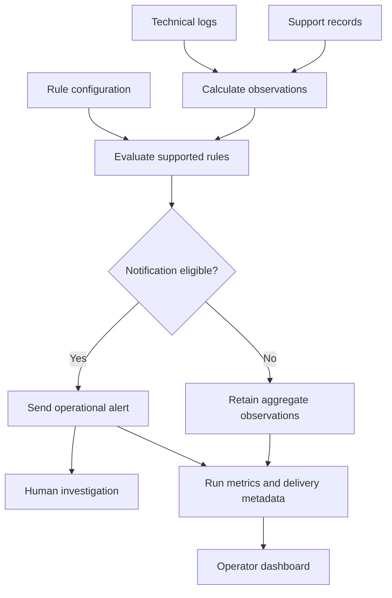

# FDS (Failure Detection System) — Engineering Case Study

FDS monitors technical-log activity and support-request volume, evaluates configured detection rules, and sends operational alerts for human investigation. I designed, built, and operate the system at **Wavve Americas (KOCOWA)**.

The project combines rule-based detection, noise controls, an operator dashboard, and visibility into the health of the monitoring job itself. It reads source systems without modifying customer accounts, subscriptions, or support tickets.

**Status:** production monitoring service. Alerts identify measured conditions that meet a rule; they do not establish root cause or perform remediation.

This document focuses on my engineering contributions. It omits source code, customer records, production thresholds and timing settings, internal system identifiers, credentials, and deployment configuration. The architecture diagram is conceptual.

## Problem

A high log count does not, by itself, establish a service incident. Recent activity needs context from a comparable historical baseline. Relative changes can also be misleading when the underlying sample is small: a large multiple of a very small baseline may have little operational significance.

Support-ticket volume introduces a different problem. Multiple tickets from the same requester can inflate a count without indicating a broader increase in affected requesters. Channel selection also matters when the goal is to measure a particular kind of incoming demand.

Monitoring creates its own operational risk when repeated or ambiguous notifications make it difficult to identify useful signals. The system needed explainable rules, controls for repeated alerts, and a way to distinguish quiet activity from a detector that did not complete its work.

## My role

I defined the detection logic and operational boundaries, implemented the log and support-volume detectors, built the browser-based operator tools, and operate the service.

My work included:

- Selecting and calculating metrics from source logs and support records.
- Combining historical comparisons with absolute-volume checks.
- Moving detection rules from code constants into an operator-managed configuration store.
- Implementing configuration caching, validation, and exception handling.
- Preventing overlapping scheduled runs and controlling repeated notifications.
- Recording run metrics and notification-delivery metadata.
- Providing dashboard views for run health, rule management, and log investigation.

## What shipped

- **Log detection:** recent activity compared with a historical baseline normalized to a comparable observation window, alongside count-based rules.
- **Minimum-volume checks:** safeguards against ratio alerts based on very small samples.
- **Support-volume detection:** distinct-requester counts with rule-specific observation windows and channel filters.
- **Operator-managed rules:** browser controls for supported thresholds, filters, priorities, and enablement settings without a code deployment.
- **Configuration resilience:** shared database-backed rule loading and a local cache, with explicit handling of successful empty rule sets.
- **Notification suppression:** detector-specific cooldown controls that reduce repeated messages during sustained conditions.
- **Execution control:** an exclusive lock prevents scheduled runs from overlapping.
- **Operational visibility:** persistent run metrics, accepted-notification metadata, and dashboard charts.
- **Log investigation:** links from alerts and dashboard history to a viewer that queries the source logs for the associated window.

## Technology

Python, pandas, SQLAlchemy, MariaDB, Flask, Gunicorn, systemd, cron, AWS, Zendesk API, and Google Chat integrations.

The production detection described here uses configured count and spike rules.

## Architecture

The scheduled job reads rule configuration and source data, calculates observations, and evaluates the applicable conditions. Notification eligibility includes the detector's suppression controls. Operators use the resulting metrics and alerts to investigate; FDS does not turn a threshold crossing into an automated account change or a root-cause claim.

| Concern | Engineering approach |
| --- | --- |
| Comparing recent and historical activity | Normalize the baseline to a comparable observation window |
| Large ratios from small samples | Require sufficient absolute volume for ratio-based checks |
| Repeat tickets from one requester | Count distinct requester IDs within the rule's filtered window |
| Different sources of support traffic | Apply rule-specific channel selection |
| Repeated notifications | Apply the relevant detector-specific cooldown |
| Configuration availability | Share rule-loading and caching behavior across detectors |
| Overlapping scheduled work | Use an exclusive execution lock |
| Investigating an alert | Provide source-log access for the associated time window |

## Operator tools

Operators receive rule-level notifications through Google Chat and use browser pages to inspect monitoring activity and adjust supported rule settings.

| Surface | Purpose |
| --- | --- |
| Overview / run health | Review recorded run status, duration, observed volumes, and notification-delivery history |
| Rules | Create, edit, enable, and disable rules; filter the list by system, state, and priority |
| Log viewer | Query source logs for the time window associated with a log alert |

**Cooldown scope.** The detectors use different suppression scopes: rule-level cooldowns and shared severity-group cooldowns. Settings exposed in a rule row do not necessarily control every detector's suppression behavior. Operator tuning applies to settings supported by the corresponding detector; the project does not provide universal per-rule cooldown control.

**Log investigation.** The viewer is a query of the source log table, not a saved copy of the exact rows originally counted. It retrieves the window associated with the notification when opened. Because it queries the source again and the window ends at notification time, the displayed rows may differ from the original detection result. This provides investigation context rather than an immutable event snapshot.

## Data handling

Support-ticket fields needed for filtering and distinct-requester counting are processed temporarily in memory. Subjects and bodies are discarded during response parsing, and the working dataset is discarded when the run ends.

FDS persists aggregate support counts and alert/run metadata. It does not persist ticket IDs, requester IDs, or ticket content. Stored delivery records describe accepted notifications without retaining their message text. Support alerts contain rule-level summaries, such as counts and observation criteria, rather than individual tickets or requesters.

For technical-log investigation, the viewer queries the existing source log table. The alert path does not create separate JSON snapshots of those logs. That describes FDS's handling; it does not imply that the source system discards its own records.

## Deep dives

### 1. Measure distinct requesters instead of raw ticket volume

**Situation.** A requester can submit multiple separate tickets about the same problem. Treating each ticket as a separate affected requester can inflate a support-volume signal.

**Constraint.** The detector needed to calculate a useful metric without building a persistent copy of individual support records. The count also needed to reflect the traffic selected by the rule.

**What I built.** The detector filters the returned records by the rule's channel criteria and counts distinct requester IDs within its observation window. Multiple matching tickets carrying the same requester ID contribute once to that rule's count. The temporary working data is discarded; aggregate results are retained for monitoring.

**What changed.** The metric describes distinct requesters represented in matching tickets rather than raw ticket submissions. It prevents repeat tickets with the same requester ID from inflating that count. It is not a count of verified unique people across multiple accounts, nor does it establish the total number of customers affected by an incident.

**Illustrative walkthrough.** A requester submits two separate tickets within a rule's observation window. Both pass the selected filters, but the detector counts their shared requester ID once. Tickets from additional requester IDs increase the count. A notification is eligible only when the configured condition and the applicable suppression checks permit it.

### 2. Give operators control over supported detection rules

**Situation.** Changing a threshold originally required a code change and deployment. That made routine adjustments dependent on engineering availability.

**Constraint.** Operators needed an understandable configuration surface, while each detector still had to interpret settings according to its implemented behavior.

**What I built.** I moved rule definitions into a database-backed configuration store and built a browser page for creating, editing, enabling, and disabling them. The configuration describes the target metric and relevant evaluation settings. Supported changes are loaded by subsequent runs without restarting the service.

The dashboard also provides recorded observations so operators can inspect activity after a change. Cooldown behavior remains detector-specific; an editable field alone is not a guarantee that every detector applies it.

**What changed.** Supported threshold and filter changes became operational tasks that could be performed through the dashboard. Rules became easier to inspect than values distributed through application code.

**Illustrative walkthrough.** An operator reviews repeated alerts, adjusts a supported threshold, and checks later observations in the dashboard. The detector reads the updated configuration on a subsequent successful load. No application deployment is needed for that supported setting.

### 3. Separate configuration availability from configuration meaning

**Situation.** A rule store can be temporarily unavailable, but a successful load can also legitimately return no enabled rules. Treating both outcomes as the same condition can restore rules an operator intentionally disabled.

**Constraint.** The detectors needed consistent configuration handling without inventing rules or confusing an empty result with a loading failure.

**What I built.** Both detectors use a shared database-backed loader with a local JSON cache. Successful loads refresh cached configuration, including empty enabled sets. Cached rules support continuity when loading fails. The loader distinguishes an available empty set from an absent cache entry, and defines how to handle unavailable configuration.

Rule interpretation is separate from transport and caching: an unsupported metric key is not guessed into a different metric. The cache contains configuration, not substitute source measurements or ticket records.

**What changed.** The detectors now follow a common loading strategy. Successfully disabling all rules for a system updates its cached configuration as well, so that a later loading failure does not simply restore the older enabled set. This does not promise immediate propagation of changes made while the configuration store is unreachable.

**Illustrative walkthrough.** A successful load returns no enabled rules and replaces the previous cached set with that empty result. A subsequent loading failure uses the cached empty configuration rather than reviving previously enabled rules. A later successful load refreshes it again.

## Engineering decisions

| Challenge | Decision |
| --- | --- |
| Relative spikes can exaggerate low-volume activity | Pair ratio comparisons with absolute-volume requirements |
| Current and historical counts need a common basis | Normalize the historical baseline to the observation window |
| Repeat submissions distort ticket totals | Count distinct requester IDs after applying rule filters |
| Operational adjustments depend on deployments | Provide database-backed rules and browser controls for supported settings |
| Empty configuration can be mistaken for an outage | Cache successful empty enabled sets and distinguish them from missing configuration |
| Sustained conditions create repeated alerts | Apply detector-specific cooldown scopes |
| Slow runs can overlap | Use a single-run lock instead of accumulating concurrent executions |
| No alerts could mean either quiet activity or missing execution | Expose recorded run health separately from notification history |
| Investigators need context around a log alert | Query the source log window rather than maintaining duplicate JSON snapshots |
| Support monitoring should not require a ticket archive | Process individual records in memory and retain aggregate results |
| A measured spike does not establish its cause | Present the observed condition for human investigation |

## Outcomes

- Deployed and operate detectors for technical-log activity and support-request volume.
- Delivered distinct-requester counting, baseline comparisons, and minimum-volume checks.
- Enabled operators to inspect and adjust supported rules without deploying application changes.
- Unified configuration loading and cache behavior across detectors.
- Provided aggregate run metrics and notification-delivery history for operational review.
- Added source-log investigation links to alerts and dashboard history without creating duplicate JSON log snapshots.
- Kept customer-system access read-only and retained aggregate support metrics instead of individual ticket records.

These outcomes describe implemented capabilities. This case study does not claim measured reductions in false positives, detection time, downtime, or support cost.
